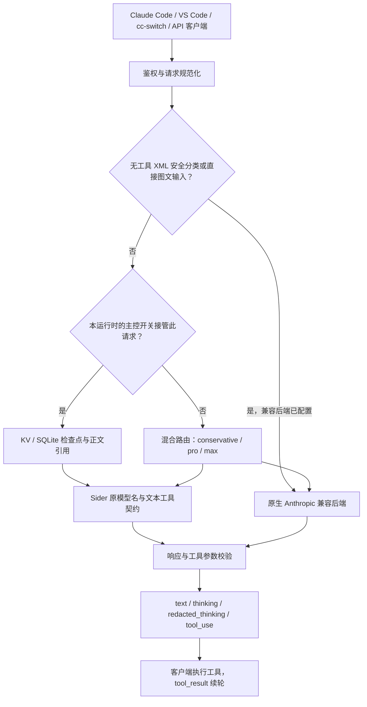

# Sider2Claude 项目说明

本文按 2026-10-12 的代码提交 `451a4f2` 核对。首次使用请看[用户使用指南](docs/用户使用指南.md)，接口详情见[API 参考](docs/API参考.md)。

Sider2Claude 将客户端请求转换为 Sider 文本通道或原生 Anthropic 兼容请求，再输出 Claude Code 可识别的响应。服务支持 Bun 本地运行、Deno 本地运行与 Deno Deploy 部署；Node.js 用于 npm 和 TypeScript 构建工具。

## 架构与路由



两种运行模式：

| 模式 | 适用行为 |
| --- | --- |
| 混合路由，`SIDER_CONTROLLER` 未设或为 `false` | 普通对话优先 Sider；`conservative/pro` 的客户端工具请求走兼容后端；`max` 可先尝试 Sider 文本契约；视觉、长文等按路由能力处理 |
| Sider 主控，`SIDER_CONTROLLER=true` | 使用严格单行 JSON 工具契约、持久化任务、账号租约、完整上下文分段和正文引用；业务回合由 Sider 处理 |
| XML 安全分类 | 无工具且 system 同时声明分类用途及 `<block>`／`<severity>` 时，优先使用已配置的原生兼容后端，主控模式也适用；不回退 Sider |

兼容后端统一由 `DEEPSEEK_BASE_URL`、`DEEPSEEK_API_KEY`、`DEEPSEEK_MODEL` 配置。默认入口为 `https://api.deepseek.com/anthropic`，默认模型为 `deepseek-v4-flash`；也可使用 Z.ai 的 `https://api.z.ai/api/anthropic` 与 `glm-5.3-flash`。日志中的后端名 `deepseek` 是内部标识，实际厂商由配置决定。

## 双运行时差异

| 项目 | Deno | Bun |
| --- | --- | --- |
| 未覆盖时的本地端口 | 8000 | 4141 |
| 主控非流式请求 | `SIDER_CONTROLLER=true` 时接管 | `SIDER_CONTROLLER=true` 时接管 |
| 主控流式请求 | 主控开启后默认接管，显式 `SIDER_CONTROLLER_STREAMING=false` 可退出；支持 KV 管理覆盖 | 主控开启后默认接管，显式 `SIDER_CONTROLLER_STREAMING=false` 可退出 |
| 主控默认单次新增输入上限 | 6,000 字符 | 14,000 字符 |
| 主控持久化 | Deno KV | `.runtime/controller.sqlite` |
| 用量统计持久化 | 配置 `STATS_KV=kv` 后使用 Deno KV | 进程内统计 |
| 策略切换与遥测 HTTP 接口 | 提供 `/stats/strategy`、`/stats/telemetry.json` | 当前入口未提供这两个接口 |
| 普通流式响应 | 按路径使用真实 SSE 或校验后合成 SSE | 主要为完整响应校验后的合成 SSE |

Deno 主控流式是“先完整校验结果，再发内容块”，等待期间每 5 秒发送 ping。收到 `message_start` 或 ping 不代表上游已生成有效回答；成功结束要检查内容、`stop_reason` 和 `message_stop`，错误要检查流内 `error`。

## 配置与启动

配置优先级为：运行时环境变量 > 第一份存在的 dotenv 文件 > 默认值。两个运行时都先读取 `deno/.env`，不存在才读取根 `.env`；两份文件不会逐字段合并。修改配置后重启服务。

在 `deno/.env` 填入自己的凭据，例如：

```env
PORT=4141
AUTH_TOKEN=your-client-token
SIDER_AUTH_TOKEN=your-sider-jwt
SIDER_API_URL=https://sider.ai/api/chat/v1/completions

DEEPSEEK_BASE_URL=https://api.deepseek.com/anthropic
DEEPSEEK_API_KEY=your-compatible-api-key
DEEPSEEK_MODEL=deepseek-v4-flash

SIDER_CONTROLLER=false
SIDER_STRATEGY=conservative
DEFAULT_BACKEND=sider
AUTO_FALLBACK=true
PREFER_SIDER_FOR_CHAT=true
DEBUG_ROUTING=false
```

从仓库根目录安装并启动；上述示例显式设置了端口，因此两种启动方式都使用 4141：

```bash
npm ci
bun run dev
# 或启动 Deno
deno task start
```

Windows 健康检查：

```powershell
Invoke-RestMethod http://localhost:4141/health
```

开启主控时按运行时选择配置模板：

- [Deno 主控模板](config/sider-controller.deno.env.example)：Deploy 需关联 Deno KV；本地路径变量在 Deploy 保持未设。
- [Bun 主控模板](config/sider-controller.bun.env.example)：运行目录必须可写，多个进程可共享同一 SQLite 文件。
- [Claude Code 客户端模板](config/claude-code.sider-controller.json.example)：客户端 token 填服务端 `AUTH_TOKEN`。

主控模板关闭业务自动回退，但 XML 分类仍使用已配置的兼容后端。更多存储与配额配置见[Sider 主控模式](docs/Sider主控模式.md)。

## Claude Code、cc-switch 与 1M 标签

客户端可以直接连接服务，也可以经 cc-switch 代理连接。客户端的 `ANTHROPIC_BASE_URL` 指向 Sider2Claude 地址或 cc-switch 本地代理地址；服务端的上游配置使用 `DEEPSEEK_*`，两者用途不同。

```powershell
$env:ANTHROPIC_BASE_URL='http://localhost:4141'
$env:ANTHROPIC_AUTH_TOKEN='your-client-token'
$env:ANTHROPIC_MODEL='claude-sonnet-5.5'
$env:ANTHROPIC_DEFAULT_SONNET_MODEL='claude-sonnet-5.5'
$env:ANTHROPIC_DEFAULT_OPUS_MODEL='claude-opus-5.5'
$env:ANTHROPIC_DEFAULT_HAIKU_MODEL='claude-haiku-5.5'
```

在 cc-switch 中选择 Claude 的 Anthropic 兼容 provider，填写服务地址、`AUTH_TOKEN` 和模型原名。若开启 1M 声明使请求名变为 `claude-sonnet-5.5[1m]`：

- 发给 Sider 的 `model` 和 `chat_models` 去掉数字 K/M 标签并规范化大小写。
- 对外响应保留客户端本次请求名。
- 主控任务、历史、请求重放及限流按基础名共享；只切换窗口标签不会重复派发工具或丢失新版本检查点。
- 窗口声明不扩大 Sider 的实际输入容量、分段数量或配额。

修改 provider 后重新启动插件会话，确认请求实际访问所选服务。完整步骤及排障见[用户使用指南](docs/用户使用指南.md)。

## 模型与能力边界

`GET /v1/models` 当前返回 106 个模型，覆盖 Claude、GPT、Gemini、DeepSeek 等家族。以该接口和两份 `config/models.ts` 为准。

模型查找支持 `[1m]`、`[200k]` 等末尾数字窗口标签；这些标签不会新增模型目录条目。混合路由对未知 Claude 名称可按家族映射；主控要求目录中明确登记的模型，否则返回 400。移除的别名可能仍触发混合路由家族映射，但不代表它们是目录条目。

- Sider 原生返回文本、推理及部分服务端工具事件；客户端工具调用由文本契约还原或由兼容后端提供。
- 直接图文输入优先交给已配置的视觉兼容后端，主控也适用；主控工具结果中的嵌套图片仍明确拒绝，实际兼容模型需支持视觉。
- Sider 的 Anthropic token 预算与 thinking 参数没有完整兑现保证；主控 usage 使用字符估算。
- XML 安全分类保留模型实际判定及错误。它不会替代客户端权限控制，也不会伪造允许结果。
- `tool_use` 由客户端执行；服务端工具结果则转成客户端可识别的文本记录。

## Write 与 PPT 工作流

合法 Write 参数保留完整路径和正文，包括中文、换行、引号、反斜杠及正文内同名字段。坏 Write JSON 或无效路径不会被猜测修补，并阻止该轮工具下发。

主控可使用内部 `StoreContent → WriteFromRef` 保存并引用完整正文；代理最终装配为客户端 Write。声明 Read 且正文在回读边界内时，写入成功后会继续 Read，比较字符数和 SHA-256；不匹配则保留原引用并要求重写。

兼容适配器还支持显式“逐字／原样／exact”请求中的“目标路径／正文开始／正文结束”边界恢复，但要求模型已经选择可解析的单个 Write，参数仍需通过校验。不能把助手的“已完成”自述当成写入证据。

ppt-master 的模板解析、素材处理、SVG 质量检查和 PPT 导出属于客户端工作流。本项目的集成验证覆盖资料抓取换工具、Write 和工具续轮；完整 PPT 是否生成，应检查客户端产物和质量报告。

## 测试与维护

```bash
npm run test:regression
deno check deno/test/integration/run.ts
npm run build
git diff --check
```

真实集成入口为 `deno/test/integration/run.ts`：默认基础套件 01–13；`E2E_CONTROLLER=true` 时加入 14–17。套件17覆盖流式接管、视觉旁路、实际文件复制及统计。发布门禁设置 `E2E_REQUIRE_ALL_PASS=true`，要求通过数等于执行总数，失败及上游受限都为 0。

```powershell
$env:E2E_BASE_URL='http://localhost:4141'
$env:E2E_REQUIRE_ALL_PASS='true'
deno task test:e2e
```

主控套件须指向已开启主控的实例，详见[测试指南](test/TEST-README.md)。本次代码基线的证据是 Deno 352/352、Bun 49/49、基础真实集成 88/88、窗口／分类真实集成 3/3；原主控其他实测记录见[主控报告](docs/Sider主控开发与集成回归报告-20261008.md)。这些不同范围的结果不合并冒充一次全套运行。

业务代码位于 `src/` 与 `deno/src/`；核心行为保持同步，运行时入口和存储差异按上表处理。新增模型同步两份目录及相关测试；源码、示例与报告均不提交真实凭据或私有生产地址。
